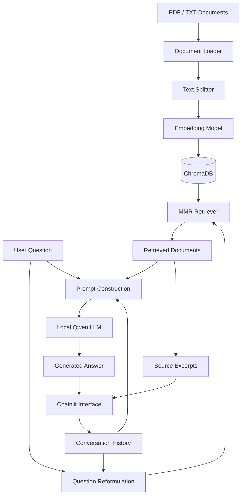

# Local RAG Chatbot

A locally running Retrieval-Augmented Generation (RAG) chatbot built with LangChain, ChromaDB and Qwen2.5. The application allows users to ask questions about their own PDF and TXT documents through a conversational interface.

The system retrieves relevant information from a local vector database and uses a locally hosted Large Language Model (LLM) to generate answers based on the retrieved context.

## Overview

This project implements a conversational RAG pipeline that combines document retrieval with local language model inference.

Instead of relying solely on the LLM's internal knowledge, the system retrieves relevant document chunks to provide context for answer generation. It also maintains conversation history to handle follow-up questions and reformulate them into standalone queries before retrieval.

The main objectives are:
- Build an end-to-end RAG pipeline.
- Process and index PDF and TXT documents.
- Perform semantic retrieval using a vector database.
- Run the language model locally with 4-bit quantization.
- Support conversational interactions with context-aware question reformulation.
- Display retrieved document excerpts alongside generated answers.

## Key Features

- **Document Loading:** Supports PDF and TXT files.
- **Text Chunking:** Splits documents into smaller chunks using a Hugging Face tokenizer.
- **Embedding Generation:** Converts text chunks into vector representations using Sentence Transformers.
- **Vector Storage:** Stores document embeddings in ChromaDB for persistent retrieval.
- **Semantic Retrieval:** Uses Maximal Marginal Relevance (MMR) to retrieve relevant and diverse document chunks.
- **Local LLM Inference:** Runs Qwen2.5-1.5B-Instruct locally with 4-bit quantization.
- **Conversational Memory:** Uses previous conversation history to understand follow-up questions.
- **Source References:** Displays retrieved document excerpts alongside generated answers.

## Tech Stack
Programming Language : Python 
RAG Framework : LangChain 
LLM : Qwen2.5-1.5B-Instruct 
Embedding Model:  all-MiniLM-L6-v2 
Vector Database:  ChromaDB 
Model Loading:  Hugging Face Transformers 
Quantization:  BitsAndBytes 
User Interface:  Chainlit 
Deep Learning:  PyTorch 

## System Architecture

The application consists of two main stages: document ingestion and question answering.

### 1. Document Ingestion

This stage processes source documents and builds the vector database. It must be completed before launching the chatbot.

**Workflow:**

1. Load PDF or TXT documents.
2. Split the extracted text into smaller chunks.
3. Generate embeddings for each chunk using `all-MiniLM-L6-v2`.
4. Store the chunks and their embeddings in ChromaDB.
5. Persist the vector database locally in `chroma_db/`.

### 2. Question Answering

Once the vector database has been created, the chatbot can use it to answer user queries.

**Workflow:**

1. Receive a user question.
2. Use conversation history to reformulate follow-up questions into standalone queries.
3. Retrieve relevant document chunks using the ChromaDB retriever.
4. Construct a prompt containing the retrieved context, conversation history and user question.
5. Generate an answer using the local Qwen model.
6. Display the answer and retrieved source excerpts in the Chainlit interface.
7. Update conversation history for subsequent interactions.

### Architecture Diagram



## Models and Configuration

### Language Model

**Qwen2.5-1.5B-Instruct**

- Model: `Qwen/Qwen2.5-1.5B-Instruct`
- Inference: Local execution using Hugging Face Transformers.
- Quantization: 4-bit using BitsAndBytes.
- Device allocation: Automatic device mapping with CPU offloading.
- Maximum new tokens: 512.
- Temperature: 0.1.

The model is loaded locally using `local_files_only=True`.

### Embedding Model

**all-MiniLM-L6-v2**

- Repository: `sentence-transformers/all-MiniLM-L6-v2`
- Framework: Hugging Face Sentence Transformers.
- Execution device: CPU.
- Used to generate embeddings for both document chunks and user queries.

### Text Splitting

The project uses `RecursiveCharacterTextSplitter` with a Hugging Face tokenizer.

| Parameter | Value |
|---|---:|
| Chunk size | 300 tokens |
| Chunk overlap | 50 tokens |
| Separators | `\n\n`, `\n`, space, empty string |

### Retrieval Configuration

The ChromaDB retriever uses Maximal Marginal Relevance (MMR).

| Parameter | Value |
|---|---:|
| Search type | MMR |
| Retrieved chunks (k) | 2 |
| Candidate documents (fetch_k) | 20 |
| Diversity parameter (lambda_mult) | 0.5 |

MMR helps balance relevance and diversity when selecting document chunks for the LLM context.

## Project Structure

```text
Local_RAG_chatbot/
│
├── data/
│   └── raw/
│       └── sample.pdf
│
├── chroma_db/                  # Generated vector database
│
├── models_cache/               # Local Hugging Face model cache
│
├── tmp_offload/                # Temporary model offloading
│
├── document_loader.py           # PDF and TXT document loading
├── text_splitter.py             # Document chunking
├── embedding_service.py         # Embedding model initialization
├── ingest_data.py               # Vector database creation
├── retriever.py                 # MMR retriever configuration
├── llm_service.py               # Local Qwen model initialization
├── rag_pipeline.py              # RAG chain implementation
├── app.py                       # Chainlit application
│
├── requirements.txt
└── README.md
```

## Installation and Setup

### Prerequisites

- Python installed.
- Git.
- Sufficient RAM and disk space for local model storage.
- A compatible PyTorch and BitsAndBytes environment for 4-bit model loading.

### 1. Clone the repository

```bash
git clone <YOUR_REPOSITORY_URL>
cd Local_RAG_chatbot
```

### 2. Create a virtual environment

```bash
python -m venv .venv
```

Activate it:

**Windows:**

```bash
.venv\Scripts\activate
```

**Linux / macOS:**

```bash
source .venv/bin/activate
```

### 3. Install dependencies

```bash
pip install -r requirements.txt
```

Make sure the installed dependencies include the packages required by the project, particularly LangChain, Chainlit, ChromaDB, Transformers, Sentence Transformers, PyTorch and BitsAndBytes.

### 4. Prepare the local models

The project uses two Hugging Face models:

- `Qwen/Qwen2.5-1.5B-Instruct`
- `sentence-transformers/all-MiniLM-L6-v2`

The Qwen model must be available in the local Hugging Face cache before starting the application because it is loaded with `local_files_only=True`.

The embedding model is initialized through Hugging Face and can be downloaded on its first use if it is not already cached.

## Usage

**Important: Run the ingestion script before launching the chatbot.**

The application expects an existing ChromaDB vector database. If it does not exist, the RAG pipeline will raise a `FileNotFoundError`.

### Step 1: Prepare your documents

Place your source documents in:

```text
data/raw/
```

Supported formats:
- `.pdf`
- `.txt`

The current ingestion entry point uses `sample.pdf` as its test input. To process another document, update the `test_file` path in `ingest_data.py` accordingly.

### Step 2: Build the vector database

Run:

```bash
python ingest_data.py
```

This script performs the following operations:

1. Loads the source document.
2. Splits the document into chunks.
3. Initializes the embedding model.
4. Generates embeddings.
5. Creates and persists the ChromaDB vector store.

After successful execution, the vector database will be available in:

```text
chroma_db/
```

You only need to perform this step again when you want to rebuild or update the indexed documents.

### Step 3: Launch the chatbot

Once the vector database has been created, start the application:

```bash
chainlit run app.py
```

Open the local URL provided by Chainlit in your browser.

You can now ask questions about the indexed documents and continue the conversation with follow-up questions.

## Example Interaction

The following example illustrates a conversation involving a follow-up question:

**User:**
> What is INSA Centre Val de Loire?

**Assistant:**
> [Answer generated using the retrieved document context.]

**User:**
> Where is it located?

The question reformulation component uses the conversation history to understand that "it" refers to INSA Centre Val de Loire before performing retrieval.

The application also displays retrieved document excerpts as references to help users inspect the information used to generate the answer.

## Limitations

- Retrieval quality depends on document quality, chunking configuration and embedding representations.
- The language model is relatively small compared with larger hosted LLMs.
- Local inference requires sufficient memory and compatible hardware/software configurations.
- The current ingestion entry point is configured around a single test document rather than automatic batch processing of an entire directory.
- Retrieved context may not always contain enough information to answer every question.

## Future Improvements

- Support batch ingestion of multiple documents.
- Implement incremental indexing to avoid rebuilding the entire vector database.
- Improve document metadata management and source-level citations.
- Experiment with different embedding models and retrieval configurations.
- Evaluate retrieval quality using dedicated metrics.
- Explore alternative chunking strategies and reranking methods.
- Improve response evaluation and hallucination handling.

## Author

Developed as a personal project to explore Retrieval-Augmented Generation, local LLM inference, vector databases and conversational AI systems.